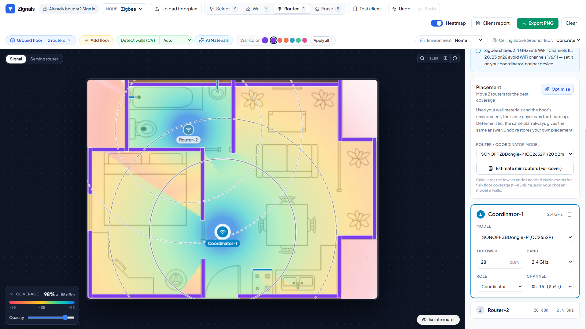
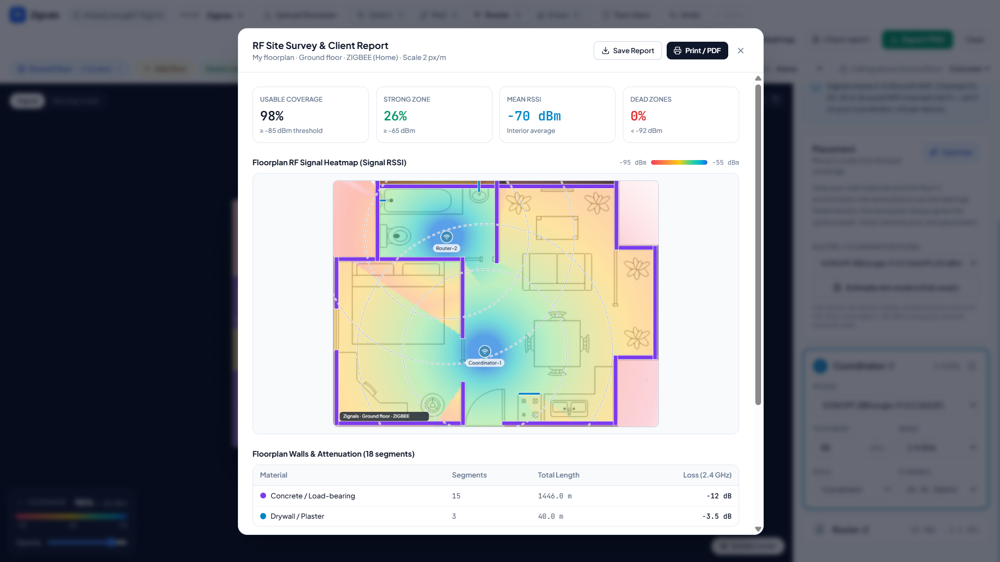

<div align="center">

# 📡 Zignals

**Interactive Wi-Fi & Zigbee Mesh RF Heatmap Floorplan Simulator with Computer Vision Wall Extraction & Minimum-Node Placement Optimization**






</div>

---

## ✨ Key Capabilities

- **Dual-Protocol RF Propagation Engine (`Zigbee` & `Wi-Fi`)** — Real-time 2D multi-wall log-distance path loss simulation (`2.4 GHz`, `5 GHz`, `6 GHz`) with multi-floor ceiling bleed-through and smooth RSSI / Serving-Router canvas overlays.
- **Deterministic 2D Computer Vision Wall Extraction** — Automatically converts uploaded floorplan images (`PNG` / `JPG` / `WebP`) into aligned wall vectors with stroke-width filtering, double-line hollow-CAD merging, diagonal Hough transform, and corner snapping.
- **Custom Wall Colors & Material Attenuation** — Assign per-material RF loss profiles (`Concrete`, `Brick`, `Drywall`, `Wood`, `Glass`, `Metal`, `Door`) and customize individual or global wall colors with a live color picker.
- **Interior-Masked Minimum Router Estimator** — Uses gap-bridged perimeter flood-fill to isolate interior rooms from exterior margins, then solves a precomputed RSSI matrix + 1-opt swap search to find the fewest routers/coordinators needed for full-floor coverage (`≥ -85 dBm`).
- **Optional Vision AI Material Classifier** — Refines CV-detected wall materials via any OpenAI-compatible Vision endpoint (`AI_BASE_URL`, `AI_KEY`, `AI_MODEL`).
- **PostgreSQL Persistence & Auth** — Multi-floor projects, walls, hardware models, routers, and client probes persisted via Drizzle ORM with JWT + `bcryptjs` authentication.

---

## 📁 Project Structure

```text
zignals/
├── docs/
│   ├── zignals-preview.png          # Application UI & RF simulation screenshot
│   └── zignals-client-report.png    # RF Site Survey & Client Report modal screenshot
├── public/                          # Static public assets (aistudio/ ignored in git)
├── src/
│   ├── components/
│   │   ├── FloorplanCanvas.tsx      # Interactive pan/zoom canvas, wall/router/client tools, HUD
│   │   ├── InspectorSidebar.tsx     # Scale calibration, placement optimizer, model estimator & node inspector
│   │   ├── Modals.tsx               # Auth modal, scale calibration dialog & client coverage report
│   │   └── TopToolbar.tsx           # Mode switcher, upload, drawing tools, wall color picker & floor tabs
│   ├── db/
│   │   ├── index.ts                 # PostgreSQL connection pool (discrete DB_* env vars + SSL)
│   │   ├── schema.ts                # Drizzle schema (users, wallMaterials, routerModels, projects, floors, walls, routers, testClients)
│   │   └── seed.ts                  # Idempotent hardware & wall material catalog + blank floorplan template seeder
│   ├── lib/
│   │   ├── floorplanRenderer.ts     # High-DPI 2D canvas renderer (sheet, walls, RF heatmap, range rings, PNG export)
│   │   ├── rfEngine.ts              # Multi-wall path loss physics, room-mask flood-fill, optimizer & min-node estimator
│   │   └── wallVisionCv.ts          # Browser-side 2D Computer Vision wall & corner extractor
│   ├── server/
│   │   ├── auth.ts                  # bcryptjs password hashing & JWT Bearer token utilities
│   │   ├── projectsRepo.ts          # Transactional project/floor hydration & persistence repository
│   │   └── wallDetector.ts          # OpenAI-compatible Vision AI wall material classification service
│   ├── types/
│   │   └── zignals.ts               # Shared TypeScript domain interfaces
│   ├── App.tsx                      # Root state, undo/redo history, debounced DB sync & shortcut bindings
│   ├── index.css                    # Tailwind CSS v4 entry & custom canvas utility styles
│   └── main.tsx                     # React 19 DOM entry point
├── .env.example                     # Environment variable template (DB, AI, App URL)
├── .gitignore                       # Excludes node_modules, dist, .env*, and public/assets/aistudio/
├── drizzle.config.ts                # Drizzle Kit configuration
├── index.html                       # HTML shell & OpenGraph metadata
├── metadata.json                    # App manifest metadata
├── package.json                     # Dependencies & npm scripts
├── server.ts                        # Express API server + Vite SSR/dev middleware / static dist host
├── tsconfig.json                    # TypeScript compiler configuration
└── vite.config.ts                   # Vite bundler + Tailwind CSS v4 plugin
```

---

## 🏗️ Apps System Architecture

```text
+-----------------------------------------------------------------------------------+
|                                 Browser Client                                    |
|                                                                                   |
|  +------------------+   +-------------------------+   +------------------------+  |
|  |   TopToolbar &   |   |    FloorplanCanvas      |   |   InspectorSidebar     |  |
|  |   Modals UI      |   |  (HTML5 2D Canvas)      |   |  (Optimiser/Estimator) |  |
|  +--------+---------+   +------------+------------+   +-----------+------------+  |
|           |                          |                            |               |
|           +--------------------------+----------------------------+               |
|                                      |                                            |
|             +------------------------+------------------------+                   |
|             v                                                 v                   |
|  +-----------------------+                         +---------------------------+  |
|  |   wallVisionCv.ts     |                         |        rfEngine.ts        |  |
|  | - Adaptive threshold  |                         | - Log-distance + wall loss|  |
|  | - Stroke-width filter |                         | - Room flood-fill mask    |  |
|  | - Hough + L/T snap    |                         | - Precomputed RSSI matrix |  |
|  +-----------------------+                         +---------------------------+  |
+--------------------------------------+--------------------------------------------+
                                       | REST JSON (Bearer JWT in memory)
                                       v
+-----------------------------------------------------------------------------------+
|                           Express Server (`server.ts`, :3000)                     |
|                                                                                   |
|  /api/bootstrap  |  /api/auth/*  |  /api/projects/*  |  /api/floors/*             |
|  /api/floorplans/detect-walls  --->  src/server/wallDetector.ts                   |
+------------------+-----------------------------------+----------------------------+
                   |                                   |
                   v                                   v (Optional)
+------------------------------------+   +------------------------------------------+
|     PostgreSQL + Drizzle ORM       |   |  OpenAI-Compatible Vision AI Endpoint    |
|  - users, projects, floors         |   |  (AI_BASE_URL / AI_KEY / AI_MODEL)       |
|  - walls, routers, test_clients    |   |  Classifies CV wall material slugs       |
|  - wall_materials, router_models   |   +------------------------------------------+
+------------------------------------+
```

### Layer Breakdown

1. **Client Simulation & Computer Vision (`src/lib/*`)**:
   - Floorplan image analysis (`wallVisionCv.ts`) runs locally in the browser using deterministic 2D image processing, avoiding LLM coordinate drift.
   - RF heatmaps (`rfEngine.ts` + `floorplanRenderer.ts`) compute per-pixel signal strength across walls, ceiling attenuation between floors, and interior room bounds on a crisp high-DPI canvas.
2. **Backend API & Auth (`server.ts`, `src/server/*`)**:
   - Single Express entry point listening on port `3000`. In development, it mounts Vite middleware; in production, it serves the compiled `dist/` bundle alongside `/api/*` routes.
   - Passwords are salted and hashed with `bcryptjs` and authenticated via signed JWTs (`Authorization: Bearer <token>`).
3. **Database Layer (`src/db/*`)**:
   - Managed with `drizzle-orm` over `postgres` (PostgreSQL / Supabase Transaction or Session Pooler) using discrete `DB_HOST`, `DB_PORT`, `DB_NAME`, `DB_USER`, `DB_PASSWORD`, and `DB_SSL` environment variables.

---

## 🛠️ Tech Stack

| Layer | Technology | Purpose |
| :--- | :--- | :--- |
| **Frontend** | React 19, TypeScript 7, Tailwind CSS v4 | Modular responsive UI, inspector controls & modals |
| **Icons & Motion** | Lucide React, Motion | Crisp vector icons and UI transitions |
| **2D Engine & CV** | HTML5 Canvas API, Custom 2D CV & RF Engine | Real-time RF heatmap rendering, wall extraction & placement math |
| **Backend** | Node.js, Express 4.21, `tsx` | REST API, static SPA serving & Vision AI proxy |
| **Database & ORM** | PostgreSQL (Supabase), Drizzle ORM, `postgres` | Relational persistence & schema migrations |
| **Auth & Security** | `jsonwebtoken`, `bcryptjs`, `cookie-parser` | User registration, login & stateless API authorization |
| **Build Tooling** | Vite 8, `esbuild`, Drizzle Kit | Fast dev middleware, optimized production bundle & DB push |

---

## 🚀 How to Build

### 1. Prerequisites

- **Node.js** `>= 20.x`
- **npm** (or `bun`)
- A **PostgreSQL** database instance (e.g., Supabase, Neon, RDS, or local Postgres)

### 2. Install Dependencies

```bash
npm install
```

### 3. Configure Environment Variables

Copy `.env.example` to `.env` and fill in your credentials (never commit `.env`):

```bash
cp .env.example .env
```

```env
# PostgreSQL Connection (Drizzle ORM)
DB_HOST=your-postgres-host
DB_PORT=5432
DB_NAME=postgres
DB_USER=postgres
DB_PASSWORD=your-password
DB_SSL=true

# Optional: JWT signing secret (auto-generated ephemerally if omitted)
JWT_SECRET=your-long-random-secret

# Optional: OpenAI-Compatible Vision AI for automatic material classification
AI_BASE_URL=https://api.openai.com/v1
AI_KEY=your-ai-api-key
AI_MODEL=gpt-4o-mini
```

### 4. Push Database Schema & Seed Catalog

```bash
npx drizzle-kit push
npx tsx src/db/seed.ts
```

### 5. Run Locally or Build for Production

```bash
# Development server (Express + Vite middleware on port 3000)
npm run dev

# Type-check & lint
npm run lint

# Build production frontend bundle into dist/
npm run build
```

---

## ☁️ How to Deploy

### Option A: Node.js / Cloud Run / VPS

Zignals builds into a static client bundle (`dist/`) served directly by the Express server (`server.ts`) on port `3000`:

1. Set all runtime environment variables (`DB_HOST`, `DB_PORT`, `DB_NAME`, `DB_USER`, `DB_PASSWORD`, `DB_SSL`, `JWT_SECRET`, and optional `AI_BASE_URL`, `AI_KEY`, `AI_MODEL`) in your hosting platform's secret manager.
2. Run the build & database migration during CI/release:
   ```bash
   npm ci
   npm run build
   npx drizzle-kit push
   ```
3. Start the production server:
   ```bash
   npm run start
   ```
   *(Runs `NODE_ENV=production tsx server.ts`, listening on `0.0.0.0:3000`.)*

### Option B: Removing Previously Pushed Scratch Assets from Git Remote

`public/assets/aistudio/` is already listed in `.gitignore`. If that directory was pushed to a remote repository earlier, untrack it from git history/index without deleting local files:

```bash
git rm -r --cached public/assets/aistudio
git commit -m "chore: untrack public/assets/aistudio and keep ignored"
git push
```
